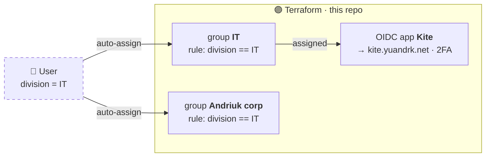
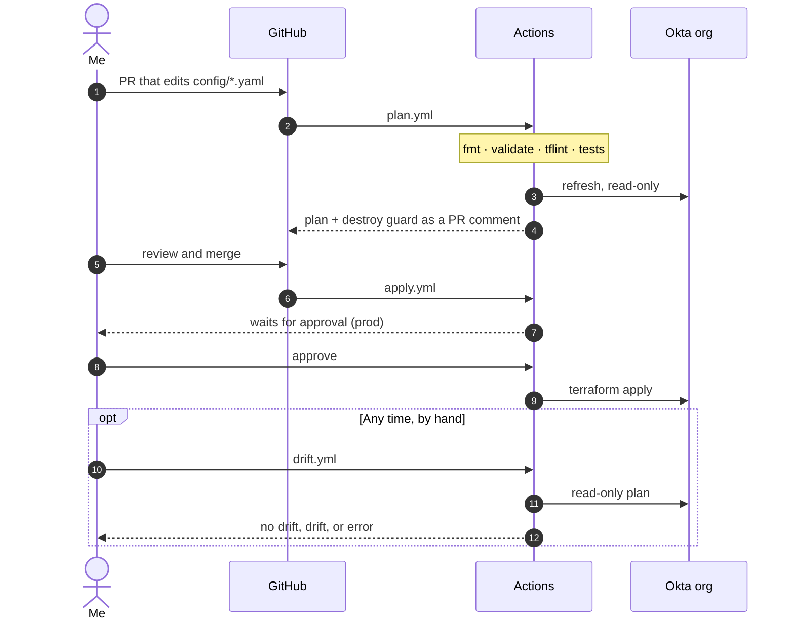

# 🔐 Okta GitOps

> Okta as the single sign-on for my homelab, managed with Terraform. Groups, auto-assignment rules and app integrations change only through a reviewed PR, a posted plan and an approved apply.

[](https://github.com/yuandrk/okta-gitops/actions/workflows/plan.yml)
[](https://github.com/yuandrk/okta-gitops/actions/workflows/apply.yml)
[](versions.tf)
[](https://registry.terraform.io/providers/okta/okta/latest/docs)
[](docs/design.md#state-s3-with-native-locking)
[](LICENSE)

## Why this exists

1. **Real SSO for the homelab.** Signing in to Kite (the k3s dashboard) goes through Okta, and the Okta side lives here.
2. **A rehearsal for Okta at work.** Import-before-apply, drift checks and MCP-assisted admin get worked out here first, on a developer org where mistakes are cheap.
3. **Learning and a portfolio.** Each resource is annotated with the Okta API call and Admin Console screen it maps to.

## Highlights

- **Changes go through a PR.** CI runs fmt, validate, tflint and the module tests, then posts the `terraform plan` as a PR comment. A plan that deletes or replaces anything fails unless the PR has the `allow-destroy` label. After the merge, the apply waits for a manual approval in the `prod` environment.
- **Data, not code.** Day-to-day edits are YAML in [`config/`](config). Validation rejects unknown group names, bad enum values and duplicate keys at plan time, before Okta sees anything.
- **Tested without an org.** `terraform test` with a mocked provider checks the `for_each` keys (state addresses) and the validations. No token, no Okta calls.
- **People aren't code.** Users are created in the Admin Console (at a company, SCIM from HR). Group rules in Okta Expression Language sort them into groups by profile attribute.
- **Drift is checked, not assumed.** A read-only drift workflow runs on demand. The `/okta-drift` Claude Code skill compares the live org, read through okta-mcp-server, with the YAML.
- **No static cloud keys.** CI reaches AWS through GitHub OIDC. State lives in S3 with native locking, so there's no DynamoDB table.

The reasoning behind each one is in [docs/design.md](docs/design.md).

## How it works

### Who gets what

Okta grants access from two things this repo owns: the group rules that put users into groups, and the assignments that open apps and tiles to those groups.



The dashed box lives in the Admin Console: users are never in Terraform. `Andriuk corp` opens nothing yet; it's the base group for future apps. More in [What's in the org](#whats-in-the-org).

### How a change ships



## What's in the org

Org `integrator-7752059.okta.com` (developer org), custom domain `okta.yuandrk.net`.

**Managed here.** `terraform output inventory` prints the same from state: per group, the rule that fills it and the apps and tiles it unlocks.

| Resource | Details |
| --- | --- |
| Group `Andriuk corp` | Rule `user.division == "IT"`. Opens nothing since Hermes was retired; the base group for future apps |
| Group `IT` | Rule `user.division == "IT"`. Gates Kite |
| Group `break-glass` | No rule: membership is set by hand. Reserved for the break-glass admin |
| OIDC app `Kite` | Web, `client_secret_post`, 2FA with 12h re-auth, `groups` claim (regex `^IT$`). Secret in 1Password `kite-credentials` |
| Authenticators `Password`, `Email` | Active. Email is allowed for recovery only. [More](docs/design.md#security-baseline-adopt-first-then-tighten) |
| Default enrollment policy | Password `REQUIRED`, Email `NOT_ALLOWED` |

**Left out on purpose**, so not drift:

| Resource | Lives in | Why |
| --- | --- | --- |
| OIDC app `okta-mcp-browser` | Admin Console | The okta-mcp-server's own device-code login. An apply that broke it would lock out the tool used to diagnose the breakage. [More](docs/design.md#the-mcps-own-app-stays-out-of-terraform) |
| Built-in groups, `okta_*` system apps | Okta | Okta adds and removes them on its own |
| Authenticator `Okta Verify` | Admin Console | Active, but the API lists it with ID `okta_verify`, which can't be fetched, so it can't be imported. [More](docs/design.md#security-baseline-adopt-first-then-tighten) |
| **Users** | Admin Console | Never in Terraform. Group rules sort them into groups. [More](docs/design.md#users-live-outside-terraform-groups-and-rules-live-inside-it) |

What changed when: [CHANGELOG.md](CHANGELOG.md).

## Quick start

You need Terraform ≥ 1.10, an AWS session with access to the state bucket, and the Okta API token. `tflint` and `terraform-docs` are only for the [local checks](docs/runbook.md#check-the-code-locally-what-ci-runs).

```bash
cp terraform.tfvars.example terraform.tfvars   # api_token: op://homelab/okta-gitops/credential
aws login                                      # session for the S3 state backend
terraform init -backend-config=backend.hcl
terraform plan                                 # expect: No changes
terraform output inventory                     # who gets what, from state
```

> [!IMPORTANT]
> **Two independent credentials.** Terraform uses an SSWS API token that dies after 30 days without API calls, so a `401 Unauthorized` means the token expired, not that the config broke. The okta-mcp-server has its own device-code login, so a working MCP proves nothing about Terraform's token. [Check the token](docs/runbook.md#before-anything-credentials) directly.

## Making a change

1. Edit [`config/groups.yaml`](config/groups.yaml) or [`config/apps.yaml`](config/apps.yaml). The runbook has recipes for a [group or rule](docs/runbook.md#add-a-group-or-change-a-rule), an [OIDC app](docs/runbook.md#add-an-oidc-app) and a [dashboard tile](docs/runbook.md#add-a-dashboard-tile-bookmark).
2. Add a dated line to [CHANGELOG.md](CHANGELOG.md).
3. Open a PR and read the plan comment. Any failed step fails the required `plan` check.
4. Merge, then approve the apply in the `prod` environment.

Something that already exists in Okta gets [imported before the apply](docs/runbook.md#adopt-something-that-was-created-in-the-console). Otherwise the apply tries to create a duplicate.

> [!WARNING]
> Names are state addresses. Renaming an app, a group or a bookmark destroys and recreates it, and a recreated OIDC app gets a new client ID and secret. The destroy guard fails the PR's `plan` check when that happens: [retire or rename on purpose](docs/runbook.md#retire-an-app-group-or-tile).

## Repository layout

```text
okta-gitops/
├── config/                     # day-to-day edits
│   ├── groups.yaml             #   groups + the rules that fill them
│   ├── apps.yaml               #   OIDC apps + bookmark tiles
│   └── security.yaml           #   authenticators + the default enrollment policy
├── main.tf                     # module calls only
├── locals.tf                   # decodes config/*.yaml
├── outputs.tf                  # inventory, OIDC client IDs and secrets
├── imports.tf                  # one-time import blocks for objects made in the Console
├── versions.tf · providers.tf · variables.tf
├── backend.hcl                 # S3 state, native locking
├── modules/                    # each with a README and tests/ (mock provider)
│   ├── identity/               #   okta_group, okta_group_rule
│   ├── apps/                   #   okta_app_oauth + policy, okta_app_bookmark, assignments
│   └── security/               #   okta_authenticator, okta_policy_mfa_default
├── .github/workflows/          # plan (PR) · apply (main, gated) · drift (manual)
├── .github/scripts/            # destroy-guard.sh, run by plan
├── renovate.json               # Renovate: dependency PRs, actions pinned to SHAs
├── .claude/skills/okta-drift/  # /okta-drift: live org vs YAML, via okta-mcp-server
└── docs/                       # design.md (why) · runbook.md (how)
```

## Docs

- [Runbook](docs/runbook.md): add a user, group, app or tile; rotate the token; check for drift; recover state
- [Design](docs/design.md): the decisions behind this setup, and the lessons that carry over to work
- [Changelog](CHANGELOG.md): what changed when, one line per PR
- Module READMEs, [identity](modules/identity/README.md) and [apps](modules/apps/README.md): inputs and outputs, generated by terraform-docs
- [CLAUDE.md](CLAUDE.md): rules for AI agents working in this repo

## License

[MIT](LICENSE)
